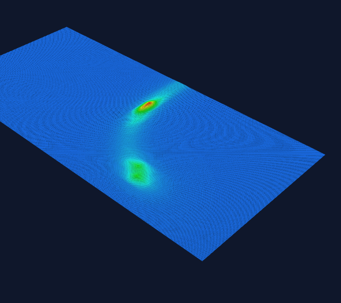
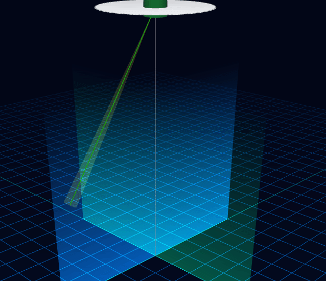
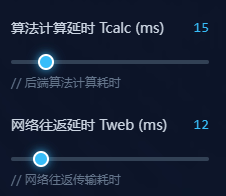

# audio_music_aoa
audio music aoa algo demo

## the entry is in x86w11_audio_music_demo_20261029.zip
   unzip it and click and run.
   
This project is a demonstration of ‌sound source DOA localization based on the MUSIC algorithm for microphone arrays‌. It can collect audio signals from an 8-channel microphone array and calculate the elevation and azimuth angles of the sound source relative to the array through the MUSIC algorithm.

The core objective of this demonstration is ‌algorithm scheme optimization‌, which provides speed demonstration for both the initial version and the optimized version.
No MUSIC algorithm implementations protected by intellectual property rights are adopted throughout the process. Only the classic MUSIC algorithm made public 10 years ago is used as the benchmark verification for the optimization effect. The project content focuses on the speed demonstration of the original version and the optimized version, rather than the accuracy improvement of the core algorithm or the performance demonstration of value-added algorithms.

Cooperation Description
Externally, only the classic MUSIC algorithm implementations commonly mentioned in public papers are provided. If a specific algorithm scheme is provided, in-depth optimization and transformation are allowed as long as they do not deviate from the core framework of the MUSIC algorithm.

Basic Parameters
Hardware Configuration‌: 8 MEMS microphone arrays, with the MCU completing audio data acquisition
Sampling Specifications‌: 16Ksamples/second sampling rate, 16-bit per-sample quantization, PCM amplitude modulation
Algorithm Parameters‌: Basic MUSIC algorithm. The number of snapshots is fixed at 8 points. The process roughly includes covariance matrix solving, noise subspace separation, spectrum search, and result refinement.
Software Architecture
The demonstration system is presented online, and the hardware cannot be displayed. Therefore, the microphone array, MCU signal acquisition, and upper-lower computer communication are not demonstrated. If there is project cooperation, we can deeply participate in the development of hardware and drivers that meet the application scenarios.
This demonstration only provides the algorithm solving part (the effect of speed optimization). The input is IQ data or time-domain waveform data, and the output is angles. It cooperates with the graphic display on the web page to reflect the optimization results.
The programs used include:

The x86 algorithm program.
The browser web page display graphical interface.
Currently, only the optimization effect demonstration for the x86 architecture is available. For embedded systems, due to the wide variety of categories, work will not start until after the project cooperation is launched. After the project cooperation starts, we will provide specific implementations for the specific hardware architecture selected in the project.
System optimization includes algorithm optimization and architecture optimization. Algorithm optimization is not platform-dependent, while architecture optimization is architecture-dependent. The optimization contribution values of the two depend on the specific architecture.
Installation Tutorial
The demonstration program can be run directly after decompression.

Usage Instructions
run two exe files(go_web_amd64.exe to start http server)
audio_music.exe is program run algorithm calculation
and open browser and access: 
localhost:8001/index.html    (az,el tracking demo)
localhost:8001/index_mesh.html  (p music graphic demo)

## 谱估计展示(pmusic graphic demo. two signal source) (click play)

## 俯仰角方位角展示 (az el tracking show)(click play)

## 控制块拖动 (control show) (play)

## algo_cal and web delay without optimization(play)

##【项目合作】 请有合作意向的 在 Discussions 或者 issues 板块联系。（这两个板块在项目头像的上一行，谢谢）
优化结果并不会在上图显示

User Permissions
The software downloaded under this project can only be used for demonstration. No secondary development or embedding into applications without project cooperation is allowed. If any commercial loss is caused, the provider of this demonstration program shall not be held responsible.

Disclaimer
The programs under this project only run on the PC and display the optimization degree on the browser web page. If they are used for other purposes, the provider of this program shall not be liable for any resulting commercial losses.
